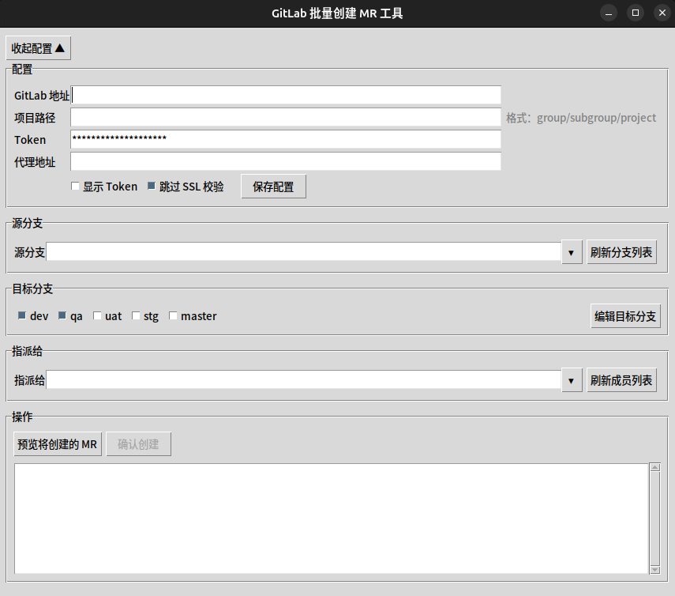

<div align="center">

# GitLab MR 批量创建工具

一键把一个源分支同时合并到多个目标分支，批量创建 Merge Request 并统一指派给指定人。


</div>

## 功能特性

- 🖱️ 图形界面（Tkinter），零命令行成本，仅依赖 `requests` 一个第三方库
- 🔀 单源分支 → 多目标分支，一次勾选批量创建 MR
- 🔍 分支/成员列表支持关键字实时搜索（本地过滤 + 远程搜索）与手动输入
- 👥 从项目成员中搜索选择指派人，创建后统一指派
- 👀 预览确认后逐个创建，已存在的未关闭 MR 自动跳过，不会重复创建
- 💾 配置与上次选择（指派人、勾选状态）自动保存在本机，下次打开自动恢复
- 🔧 支持自建 GitLab、代理、跳过 SSL 校验、超时时间等设置

## 演示



## 环境要求

- Python 3.8+（需自带 Tkinter，官方安装包默认包含）
- 一枚勾选了 `api` 权限的 GitLab Personal Access Token
  （`GitLab 右上角头像 → Preferences → Access Tokens` 创建）

## 安装

```bash
git clone https://github.com/your-name/gitlab-mr-tool.git
cd gitlab-mr-tool
pip3 install requests
```

## 快速开始

```bash
python3 gitlab_mr_tool.py    # Windows 下: python gitlab_mr_tool.py
```

1. 在「配置」区填写 GitLab 地址、项目路径、Token，点「保存配置」
2. 点「刷新分支列表」，选择或输入源分支
3. 勾选目标分支（可点「编辑目标分支」增删常用分支）
4. 点「刷新成员列表」，选择指派人
5. 点「预览将创建的 MR」，核对表格后点「确认创建」

## 使用示例

典型场景：功能分支 `feature/order-export` 开发完成，需要同时合入 `dev`、`qa`、`uat`、`stg` 四个环境分支并指派给审查人。

1. 源分支选择 `feature/order-export`
2. 勾选 `dev` / `qa` / `uat` / `stg`
3. 指派人选择 `张三 (zhangsan)`
4. 预览确认后，工具依次创建 4 个 MR；若某个方向已存在未关闭的 MR，则标记为「跳过」并给出链接

## 配置说明

配置保存在 `~/.gitlab_mr_tool/config.json`（首次保存后生成），可参考 [`config.example.json`](config.example.json) 手工编辑。

| 配置项 | 类型 | 默认值 | 说明 |
|--------|------|--------|------|
| `gitlab_url` | str | `https://gitlab.example.com` | GitLab 实例地址 |
| `project_path` | str | 空 | 项目路径，格式 `group/subgroup/project` |
| `token` | str | 空 | Personal Access Token（需 `api` 权限） |
| `proxy` | str | 空 | 代理地址，如 `http://127.0.0.1:7890`，留空直连 |
| `verify_ssl` | bool | `true` | 是否校验 SSL 证书 |
| `timeout` | int | `30` | 请求超时（秒） |
| `branch_limit` | int | `100` | 拉取分支数量上限 |
| `target_branches` | list | `["dev", "qa", "uat", "stg"]` | 常用目标分支 |
| `last_assignee` | str | 空 | 上次指派人（自动记录） |
| `last_checked_targets` | list | `[]` | 上次勾选的目标分支（自动记录） |

> ⚠️ Token 以明文保存在本机配置文件中，请勿在共享环境使用；日志不会记录 Token。

## 项目结构

```
gitlab-mr-tool/
├── gitlab_mr_tool.py    # 主程序（GUI + GitLab API 封装）
├── config.example.json  # 配置文件示例
├── build.sh             # PyInstaller 打包脚本
├── gitlab_mr_tool.spec  # PyInstaller 打包配置
├── LICENSE
└── README.md
```

## 开发与测试

```bash
pip3 install requests pyinstaller

# 从源码运行
python3 gitlab_mr_tool.py

# 打包为单文件可执行程序（产物在 dist/gitlab_mr_tool）
./build.sh
```

暂无自动化测试，欢迎贡献。

## 贡献指南

1. Fork 本仓库并创建新分支：`git checkout -b feature/your-feature`
2. 提交更改：`git commit -m "feat: add your feature"`
3. 推送并创建 Pull Request

提交信息建议遵循 [Conventional Commits](https://www.conventionalcommits.org/zh-hans/)。

## 许可证

[MIT](LICENSE)
